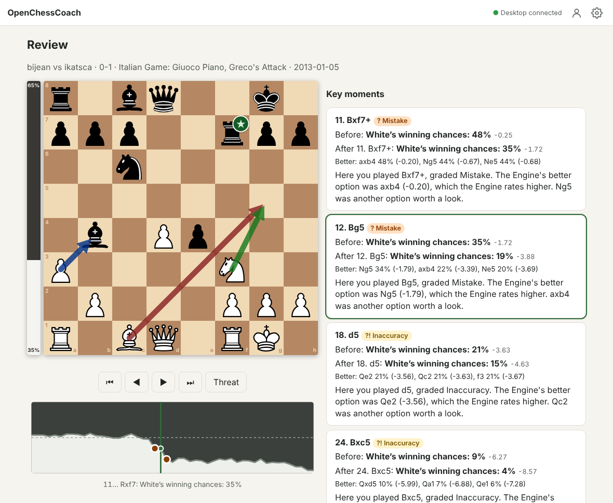

# OpenChessCoach

A chess coach that runs on your own desktop: the Engine (Stockfish) judges every move, and Claude,
the Coach, explains why in plain words, on your own Claude subscription.



No Node.js, npm, Git, or administrator rights required. Open a terminal and install:

**Windows (PowerShell):**

```powershell
irm https://github.com/inprealpha/OpenChessCoach/releases/latest/download/install.ps1 | iex
```

**macOS or Linux (Terminal):**

```bash
curl -fsSL https://github.com/inprealpha/OpenChessCoach/releases/latest/download/install.sh | bash
```

Then install [Claude Code](https://claude.com/claude-code), sign in once with `claude`, and start
OpenChessCoach from your Start Menu (**OpenChessCoach**, on Windows) or by running `openchesscoach`.
Already have Node.js 22.19+? You can also run `npx openchesscoach@latest` without installing
anything first: see [Install with npm](#already-have-nodejs-npx).

- **Review your own games** from Lichess, chess.com or a PGN: every move gets a Move Grade, a graph
  shows where the game turned, and the Coach sums up the whole game, then walks you through the
  key moments.
- **Play the Engine** at your strength, with Live Coaching and Hints.
- **Learn** from your first moves to the end of intermediate level: 64 Lessons on Themes such as
  forks and pins, endgames, openings, and how to think during a game, with the next Lesson
  suggested as you go, then practise them in Puzzles.
- **Ask the Coach why** a move is good or bad, beside any board.
- **See the verdicts at a glance**: Winning Chances as a percentage and a bar, Move Grade symbols on
  the board, and a Threat arrow for what your opponent wants next.
- **Play on your phone**: the first time the app opens on your desktop, it shows a QR code to scan
  with your phone.

## What you need

- **A desktop or laptop** running 64-bit Windows 10/11 (x64 or ARM64), macOS 13+ (Apple Silicon or
  Intel), or Linux (x64 or ARM64, glibc such as Ubuntu, Debian, Fedora, Arch). Phones and tablets
  connect to it over Wi-Fi or an optional tunnel.
- **Claude Code, logged in** with a paid Claude plan (Pro or Max). The Coach uses your own Claude
  Code login; the app never sees your password or token. The free Claude plan does not include
  Claude Code.

You do **not** need Node.js or npm for the standalone install — it bundles the official signed
Node.js runtime for your system.

## Install

### Windows (stock Windows 10 or 11)

1. Press **Start**, type **PowerShell**, and open **Windows PowerShell** (regular user, no
   administrator needed).
2. Install OpenChessCoach:

   ```powershell
   irm https://github.com/inprealpha/OpenChessCoach/releases/latest/download/install.ps1 | iex
   ```

   This downloads the verified zip for your PC (x64 or ARM64) into `%LOCALAPPDATA%\OpenChessCoach`,
   adds `openchesscoach` to your user `PATH`, and adds an **OpenChessCoach** shortcut to your Start
   Menu. It works under Windows' default PowerShell script policy (`Restricted`).
3. Install Claude Code and sign in (skip if you already have it):

   ```powershell
   irm https://claude.ai/install.ps1 | iex
   ```

   Close PowerShell, open a **new** PowerShell window, run `claude`, sign in with your Claude Pro
   or Max account, and type `/exit`.
4. Start OpenChessCoach from the Start Menu (**OpenChessCoach**) or by running `openchesscoach` in
   a new PowerShell window.

### macOS (Apple Silicon and Intel)

1. Press **⌘+Space**, type **Terminal**, and press **Enter**.
2. Install OpenChessCoach:

   ```bash
   curl -fsSL https://github.com/inprealpha/OpenChessCoach/releases/latest/download/install.sh | bash
   ```

   This installs to `~/.local/share/openchesscoach-app` and links `openchesscoach` into
   `~/.local/bin`.
3. Install Claude Code and sign in (skip if you already have it):

   ```bash
   curl -fsSL https://claude.ai/install.sh | bash
   ```

   Open a **new** Terminal window, run `claude`, sign in with your Claude Pro or Max account, and
   type `/exit`.
4. Start OpenChessCoach by running `openchesscoach` in a new Terminal window.

### Linux (Ubuntu, Debian, Fedora, Arch, …)

1. Open a terminal (**Ctrl+Alt+T** on most desktops).
2. Install OpenChessCoach:

   ```bash
   curl -fsSL https://github.com/inprealpha/OpenChessCoach/releases/latest/download/install.sh | bash
   ```

   Needs `curl` and `tar` (preinstalled on most desktop distros; on minimal installs, install them
   with your package manager first). On Alpine or other musl-based Linux distros, use the
   [Node.js / npx route](#already-have-nodejs-npx) instead.
3. Install Claude Code and sign in (skip if you already have it):

   ```bash
   curl -fsSL https://claude.ai/install.sh | bash
   ```

   Open a **new** terminal, run `claude`, sign in with your Claude Pro or Max account, and type
   `/exit`.
4. Start OpenChessCoach by running `openchesscoach` in a new terminal.

### Portable download (no install script)

Prefer not to pipe a script to a shell? Download the archive for your system (`win-x64.zip`,
`win-arm64.zip`, `darwin-arm64.tar.gz`, `darwin-x64.tar.gz`, `linux-x64.tar.gz`, or
`linux-arm64.tar.gz`) and `SHA256SUMS.txt` from
[GitHub Releases](https://github.com/inprealpha/OpenChessCoach/releases/latest), verify the
checksum, extract it anywhere, and run `openchesscoach.cmd` (Windows) or `./openchesscoach`
(macOS/Linux).

### Already have Node.js? (`npx`)

If you already have **Node.js 22.19 or later** (`node --version`), you can run OpenChessCoach
directly from npm without installing the standalone bundle:

```bash
npx openchesscoach@latest
```

`@latest` picks up the newest release each time you start the app.

On **Windows PowerShell**, `npx` is a `.ps1` script and PowerShell blocks scripts by default
("running scripts is disabled on this system"). Either use `npx.cmd openchesscoach@latest`, or allow
locally installed scripts once for your user account (no administrator needed):

```powershell
Set-ExecutionPolicy -Scope CurrentUser RemoteSigned
```

If you need Node.js on Windows, macOS or Linux for the `npx` route, download the LTS installer from
<https://nodejs.org/en/download> (or `winget install OpenJS.NodeJS.LTS` on Windows, `brew install node`
on macOS, or [nvm](https://github.com/nvm-sh/nvm) on Linux).

## Start, update, and uninstall

- **Start:** run `openchesscoach` (or click **OpenChessCoach** in the Windows Start Menu; or
  `npx openchesscoach@latest` if using npm). Keep the terminal window open while you play.
- **Stop:** press **Ctrl+C** in that terminal window (or close it).
- **Update:** re-run the install command for your system above — it replaces the app files cleanly
  and keeps your games and Player Profile. (With `npx openchesscoach@latest`, every start already
  uses the latest version.)
- **Uninstall:**
  - Windows (PowerShell):
    ```powershell
    & ([scriptblock]::Create((irm https://github.com/inprealpha/OpenChessCoach/releases/latest/download/install.ps1))) -Uninstall
    ```
  - macOS / Linux:
    ```bash
    curl -fsSL https://github.com/inprealpha/OpenChessCoach/releases/latest/download/install.sh | bash -s -- --uninstall
    ```
  Uninstalling removes the program files and shortcut while keeping your games and Player Profile.
  To delete your saved data too, remove your data folder (paths below).

The desktop checks Claude Code, starts the app and opens your browser already paired. The first
thing the browser shows is a QR code: scan it with your phone on the same Wi-Fi to open the app
there, already paired, and carry on setting up on the phone. The desktop prints the same QR code.
Until a phone is paired, the main menu on the desktop asks again every few days, unless you choose
**Don't ask again**.

Browsers keep an offline copy of the app only on an `https://` address or on the desktop itself.
There you can add the app to your home screen (or install it, on the desktop) to use it like an
app: the board, the Engine, Lessons and Puzzles keep working when the desktop can't be reached,
and Engine Games played offline are saved when it comes back. The QR code's Wi-Fi address is plain
`http://`, so a phone on it needs the desktop running each time it opens the app. For an
`https://` address on your phone, see [Away from home](#away-from-home).

Options: `--port <n>` (default 8737), `--host <address>`, `--data-dir <path>`, `--coach <backend>` (`claude`, `codex`, `pi`, or `opencode`; auto-detected when omitted), `--no-open`, `--version`, `--help`. Your games and
Player Profile live in one SQLite file in your data folder (on Linux `~/.local/share/ai-chess-coach`,
on macOS `~/Library/Application Support/ai-chess-coach`, on Windows `%APPDATA%\ai-chess-coach`).

### Coach backends (Claude, Codex, Pi, and OpenCode)

OpenChessCoach supports four Coach backends on your desktop:

- **Claude** (Claude Code CLI — `claude login`)
- **Codex** (OpenAI Codex CLI — `codex login` with your ChatGPT subscription, or `OPENAI_API_KEY`)
- **Pi** (Pi coding agent — run `pi` and `/login`, or configure a provider API key in `~/.pi`)
- **OpenCode** (OpenCode CLI — `opencode auth login`, or OpenCode's free Zen models)

At startup, OpenChessCoach picks the first ready backend automatically (or the one passed via `--coach <backend>`). When more than one backend is ready on your desktop, you can switch between them live in **Settings → Coach backend**. To smoke-test your local backend(s) from the terminal, run:

```sh
npm run smoke:coach
# or target a single backend:
npm run smoke:coach -- --provider codex
npm run smoke:coach -- --provider pi
npm run smoke:coach -- --provider opencode
```

## Common issues

- **`openchesscoach` is not recognized / command not found:** close your terminal and open a **new**
  one so it picks up the updated `PATH`. On Windows, you can also launch **OpenChessCoach** from the
  Start Menu. On macOS/Linux, check that `~/.local/bin` is in your `PATH`.
- **Claude Code is not installed / not logged in / login expired:** install Claude Code from
  <https://claude.com/claude-code>, open a new terminal, run `claude` (or `/login` inside `claude`),
  sign in with a paid Claude Pro or Max account, then start OpenChessCoach again.
- **Port 8737 is already in use:** OpenChessCoach is probably already running in another terminal
  window. Otherwise start it on another port: `openchesscoach --port 8738`.
- **Browser doesn't open automatically (especially headless or minimal Linux):** open the
  `http://127.0.0.1:8737/#pair=…` link printed in the terminal under the QR code.
- **Claude usage limit reached:** the Coach shares your Claude plan's limits and shows when they
  reset. The board, Engine, Lessons, and Puzzles keep working offline and without Claude.

## My phone can't open the app

If your phone's browser says it can't connect after you scan the QR code, something is keeping it
from reaching your desktop. The quickest fix works whatever the cause: leave the QR code on the
desktop's screen for a couple of minutes, and when it asks **Phone can't open it?**, press
**Connect another way**. The desktop then reaches your phone through a Cloudflare tunnel (the same
one as [Away from home](#away-from-home)) and shows a new QR code to scan. Its address changes each
time you start the app, so scan again after a restart: Settings shows the new code under Away from
home. Or find the cause:

- **Windows:** when the app starts, Windows asks whether Node.js can use your networks. Tick both
  boxes (Private and Public) and click **Allow access**. If you clicked Cancel, open **Windows
  Security → Firewall & network protection → Allow an app through firewall**, find Node.js, and tick
  both boxes.
- **macOS:** if your Mac asks whether `node` can accept incoming network connections, click
  **Allow**. If you clicked Deny, open **System Settings → Network → Firewall → Options** and set
  node to allow incoming connections.
- **Linux:** most systems have no firewall on, but some do (CachyOS turns on ufw). When ufw or
  firewalld is on, the desktop prints the one command that lets devices on your Wi-Fi reach the app,
  such as `sudo ufw allow from 192.168.1.0/24 to any port 8737 proto tcp comment 'OpenChessCoach'`,
  under the QR code, with your own network and port. Run it once.
- **Mobile data, guest Wi-Fi or a VPN:** the phone must be on the same Wi-Fi as the desktop, and
  some guest networks and routers keep devices apart. Nothing on the desktop can change that: use
  **Connect another way**.

The app never changes your firewall itself: that needs administrator rights, and it doesn't help
on a guest Wi-Fi.

## Pairing

Only devices that scanned the QR code, or typed the pairing code shown on the desktop, can use the
app: nobody else on your network can spend your Claude limits. Settings shows the QR code again,
and **Reset pairing** signs every other device out.

## Away from home

Two ways to reach your desktop from outside your Wi-Fi:

- **The away-from-home checkbox** in Settings starts a Cloudflare quick tunnel. It needs no
  account (the app downloads `cloudflared` the first time) and shows a new QR code. Pairing still
  applies. The address is `https://`, so the app works offline there too, but it changes each time
  the tunnel starts, including every time you start the app: scan again after a restart.
  The phone treats each address as a separate app, so Engine Games played offline under an old
  address are never sent to the desktop.
- **Tailscale**, if you already use it or want a fixed address:
  1. Install Tailscale on the desktop and the phone and sign in to the same tailnet
     (<https://tailscale.com/download>).
  2. Start OpenChessCoach as usual. Find the desktop's Tailscale name with `tailscale status`.
  3. On the phone, open `http://<desktop-name>:8737/` and type the pairing code from the desktop.
  4. For the offline app and Stockfish's faster multi-threaded mode in the phone's browser, the
     browser needs HTTPS:
     run `tailscale serve --bg 8737` on the desktop and open the `https://<desktop-name>.<tailnet>.ts.net`
     address it prints instead. It stays the same, so add that one to your home screen.

## Coach quality

Settings → Coach quality picks how much of your Claude limits the Coach uses:

- **Thrifty**: Haiku for every job.
- **Balanced**: Sonnet for Reviews (the overview and the key moments), Why Questions and Lessons;
  Haiku for Hints and Live Coaching.
- **Best** (the default): Opus for Reviews (the overview and the key moments), Why Questions and
  Lessons; Haiku for Hints and Live Coaching, which must stay quick (Haiku was measured good enough
  for them: `docs/research/hint-and-live-coaching-models.md`).

Under **Advanced** you can choose the model for each job yourself; the choice then shows as Custom.
A Review's overview uses the model chosen for Reviews. Settings → Reviews turns the overview off,
which saves one Coach call per Review.
The models are named by family (`haiku`, `sonnet`, `opus`), and the Claude Agent SDK maps each to
the newest model of that family it knows, so updating the app keeps the Coach on the latest models.

## For contributors

To run your own changes, start the app from a copy of this repository:

```bash
git clone https://github.com/inprealpha/OpenChessCoach.git
cd OpenChessCoach
npm ci
npm run build -w @chess-coach/web
npm start                 # options go after --, as in npm start -- --port 9000
```

After `git pull`, run `npm ci` and the build again. Then:

```bash
npm test                          # unit, golden, data and protocol tests
npx playwright install chromium   # once: the browser the Player journeys run in
npm run test:journeys             # the Player journeys in a real browser
npm run verify                    # a disposable verify-mode copy of the app for checking a change
```

To set up a whole machine in one step (a new computer, or a sandbox where agents work), run
`bash scripts/sandbox/prepare.sh`: it installs the dependencies and the browser, builds the web app
and downloads the Maia-3 model. On a Linux machine that has never run a browser, Chromium also needs
its system libraries, which take root: `sudo npx playwright install-deps chromium`. To try a branch
on your phone, `bash scripts/sandbox/instabox.sh up --notify` runs it on an InstaBox box and sends you
the link; `.claude/skills/sandbox/SKILL.md` has the details.

Read `AGENTS.md` and `.claude/skills/verify/SKILL.md` before opening a PR: changes merge on
evidence from the running app (`docs/adr/0006-merge-on-evidence.md`).

## Licence

GPL-3.0-or-later. Stockfish, the chess pieces and the Lesson and Puzzle data have their own
licences and credits: see `THIRD_PARTY_NOTICES.md`.
