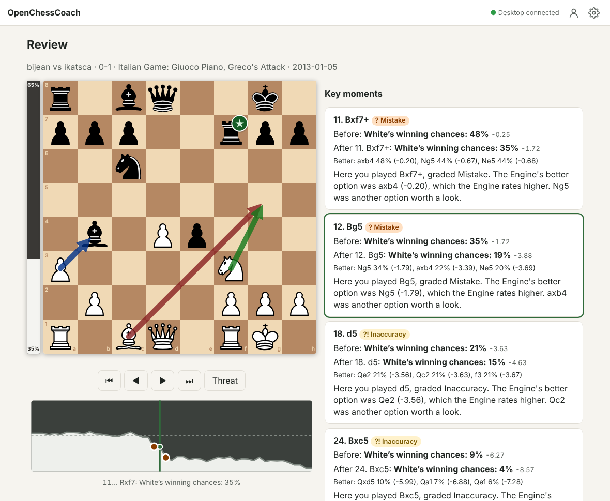

# OpenChessCoach

A chess coach that runs on your own desktop: the Engine (Stockfish) judges every move, and Claude,
the Coach, explains why in plain words, on your own Claude subscription.



```bash
npx openchesscoach@latest
```

You need Node.js 22.18 or later and Claude Code, logged in: see [What you need](#what-you-need).
On Windows, let PowerShell run `npx` once first: see
[Letting PowerShell run npx](#letting-powershell-run-npx-windows).

- **Review your own games** from Lichess, chess.com or a PGN: every move gets a Move Grade, a graph
  shows where the game turned, and the Coach sums up the whole game, then walks you through the
  key moments.
- **Play the Engine** at your strength, with Live Coaching and Hints.
- **Learn** from your first moves to the end of intermediate level: 64 Lessons on Themes such as
  forks and pins, endgames, openings, and how to think during a game, with the next Lesson
  suggested as you go, then practise them in Puzzles.
- **Ask the Coach why** a move is good or bad, beside any board.
- **See the verdicts at a glance**: Winning Chances as a percentage and a bar, Move Grade symbols on
  the board, and a Threat arrow for what your opponent wants next.
- **Play on your phone**: the first time the app opens on your desktop, it shows a QR code to scan
  with your phone.

## What you need

- **Node.js 22.18 or later** (`node --version`). Node.js brings `npm` and `npx` with it, so
  you install nothing else. If `node --version` says the command is not found, or shows a
  version older than 22.18, see [Installing Node.js](#installing-nodejs).
- **Claude Code, logged in** with a paid Claude plan (Pro or Max): install it from
  <https://claude.com/claude-code>, run `claude` once and log in. The Coach uses that login; the
  app never sees your password or token.
- A desktop running macOS, Windows or Linux. Phones and tablets connect to it.

### Installing Node.js

Open a terminal (on Windows, PowerShell; on macOS, the Terminal app) and run the command for your
system.

On Windows:

```powershell
winget install OpenJS.NodeJS.LTS
```

Then close PowerShell and open a new one, so it finds `node`, and let it run `npx` (next section).

On macOS or Linux:

```bash
curl -o- https://raw.githubusercontent.com/nvm-sh/nvm/v0.40.3/install.sh | bash
```

Then close the terminal, open a new one, and run:

```bash
nvm install --lts
```

Check that it worked with `node --version`. If you prefer an installer you click through, download
the LTS version from <https://nodejs.org/en/download>.

### Letting PowerShell run npx (Windows)

`npx` and `npm` are PowerShell scripts on Windows, and PowerShell doesn't run scripts until you
allow them, so `npx` stops with "running scripts is disabled on this system". Allow them once, in
PowerShell:

```powershell
Set-ExecutionPolicy -Scope CurrentUser RemoteSigned
```

If it asks whether to change the execution policy, type `Y` and press Enter. `RemoteSigned` runs
scripts installed on your computer, such as the ones Node.js brings, and still blocks unsigned
scripts downloaded from the internet. `-Scope CurrentUser` changes it only for your Windows account,
so you don't need to run PowerShell as an administrator. Check it with `Get-ExecutionPolicy`,
which should print `RemoteSigned`. If it prints something else, a policy your organization set wins
over yours: type `npx.cmd` instead.

If you'd rather leave the policy as it is, type `npx.cmd` instead of `npx` in every command here.

## Start

```bash
npx openchesscoach@latest
```

`@latest` picks up the newest release each time you start the app. In Windows PowerShell, if it
says running scripts is disabled, see
[Letting PowerShell run npx](#letting-powershell-run-npx-windows).

The desktop checks Claude Code, starts the app and opens your browser already paired. The first
thing the browser shows is a QR code: scan it with your phone on the same Wi-Fi to open the app
there, already paired, and carry on setting up on the phone. The desktop prints the same QR code.
Until a phone is paired, the main menu on the desktop asks again every few days, unless you choose
**Don't ask again**.

Browsers keep an offline copy of the app only on an `https://` address or on the desktop itself.
There you can add the app to your home screen (or install it, on the desktop) to use it like an
app: the board, the Engine, Lessons and Puzzles keep working when the desktop can't be reached,
and Engine Games played offline are saved when it comes back. The QR code's Wi-Fi address is plain
`http://`, so a phone on it needs the desktop running each time it opens the app. For an
`https://` address on your phone, see [Away from home](#away-from-home).

Options: `--port <n>` (default 8737), `--host <address>`, `--data-dir <path>`, `--no-open`, `--version`, `--help`. Your games and
Player Profile live in one SQLite file in your data folder (on Linux `~/.local/share/ai-chess-coach`,
on macOS `~/Library/Application Support/ai-chess-coach`, on Windows `%APPDATA%\ai-chess-coach`).

## My phone can't open the app

If your phone's browser says it can't connect after you scan the QR code, something is keeping it
from reaching your desktop. The quickest fix works whatever the cause: leave the QR code on the
desktop's screen for a couple of minutes, and when it asks **Phone can't open it?**, press
**Connect another way**. The desktop then reaches your phone through a Cloudflare tunnel (the same
one as [Away from home](#away-from-home)) and shows a new QR code to scan. Its address changes each
time you start the app, so scan again after a restart: Settings shows the new code under Away from
home. Or find the cause:

- **Windows:** when the app starts, Windows asks whether Node.js can use your networks. Tick both
  boxes (Private and Public) and click **Allow access**. If you clicked Cancel, open **Windows
  Security → Firewall & network protection → Allow an app through firewall**, find Node.js, and tick
  both boxes.
- **macOS:** if your Mac asks whether `node` can accept incoming network connections, click
  **Allow**. If you clicked Deny, open **System Settings → Network → Firewall → Options** and set
  node to allow incoming connections.
- **Linux:** most systems have no firewall on, but some do (CachyOS turns on ufw). When ufw or
  firewalld is on, the desktop prints the one command that lets devices on your Wi-Fi reach the app,
  such as `sudo ufw allow from 192.168.1.0/24 to any port 8737 proto tcp comment 'OpenChessCoach'`,
  under the QR code, with your own network and port. Run it once.
- **Mobile data, guest Wi-Fi or a VPN:** the phone must be on the same Wi-Fi as the desktop, and
  some guest networks and routers keep devices apart. Nothing on the desktop can change that: use
  **Connect another way**.

The app never changes your firewall itself: that needs administrator rights, and it doesn't help
on a guest Wi-Fi.

## Pairing

Only devices that scanned the QR code, or typed the pairing code shown on the desktop, can use the
app: nobody else on your network can spend your Claude limits. Settings shows the QR code again,
and **Reset pairing** signs every other device out.

## Away from home

Two ways to reach your desktop from outside your Wi-Fi:

- **The away-from-home checkbox** in Settings starts a Cloudflare quick tunnel. It needs no
  account (the app downloads `cloudflared` the first time) and shows a new QR code. Pairing still
  applies. The address is `https://`, so the app works offline there too, but it changes each time
  the tunnel starts, including every time you start the app: scan again after a restart.
  The phone treats each address as a separate app, so Engine Games played offline under an old
  address are never sent to the desktop.
- **Tailscale**, if you already use it or want a fixed address:
  1. Install Tailscale on the desktop and the phone and sign in to the same tailnet
     (<https://tailscale.com/download>).
  2. Start OpenChessCoach as usual. Find the desktop's Tailscale name with `tailscale status`.
  3. On the phone, open `http://<desktop-name>:8737/` and type the pairing code from the desktop.
  4. For the offline app and Stockfish's faster multi-threaded mode in the phone's browser, the
     browser needs HTTPS:
     run `tailscale serve --bg 8737` on the desktop and open the `https://<desktop-name>.<tailnet>.ts.net`
     address it prints instead. It stays the same, so add that one to your home screen.

## Coach quality

Settings → Coach quality picks how much of your Claude limits the Coach uses:

- **Thrifty**: Haiku for every job.
- **Balanced**: Sonnet for Reviews (the overview and the key moments), Why Questions and Lessons;
  Haiku for Hints and Live Coaching.
- **Best** (the default): Opus for Reviews (the overview and the key moments), Why Questions and
  Lessons; Haiku for Hints and Live Coaching, which must stay quick (Haiku was measured good enough
  for them: `docs/research/hint-and-live-coaching-models.md`).

Under **Advanced** you can choose the model for each job yourself; the choice then shows as Custom.
A Review's overview uses the model chosen for Reviews. Settings → Reviews turns the overview off,
which saves one Coach call per Review.
The models are named by family (`haiku`, `sonnet`, `opus`), and the Claude Agent SDK maps each to
the newest model of that family it knows, so updating the app keeps the Coach on the latest models.

## For contributors

To run your own changes, start the app from a copy of this repository:

```bash
git clone https://github.com/inprealpha/OpenChessCoach.git
cd OpenChessCoach
npm ci
npm run build -w @chess-coach/web
npm start                 # options go after --, as in npm start -- --port 9000
```

After `git pull`, run `npm ci` and the build again. Then:

```bash
npm test                          # unit, golden, data and protocol tests
npx playwright install chromium   # once: the browser the Player journeys run in
npm run test:journeys             # the Player journeys in a real browser
npm run verify                    # a disposable verify-mode copy of the app for checking a change
```

To set up a whole machine in one step (a new computer, or a sandbox where agents work), run
`bash scripts/sandbox/prepare.sh`: it installs the dependencies and the browser, builds the web app
and downloads the Maia-3 model. On a Linux machine that has never run a browser, Chromium also needs
its system libraries, which take root: `sudo npx playwright install-deps chromium`. To try a branch
on your phone, `bash scripts/sandbox/instabox.sh up --notify` runs it on an InstaBox box and sends you
the link; `.claude/skills/sandbox/SKILL.md` has the details.

Read `CLAUDE.md` and `.claude/skills/verify/SKILL.md` before opening a PR: changes merge on
evidence from the running app (`docs/adr/0006-merge-on-evidence.md`).

## Licence

GPL-3.0-or-later. Stockfish, the chess pieces and the Lesson and Puzzle data have their own
licences and credits: see `THIRD_PARTY_NOTICES.md`.
