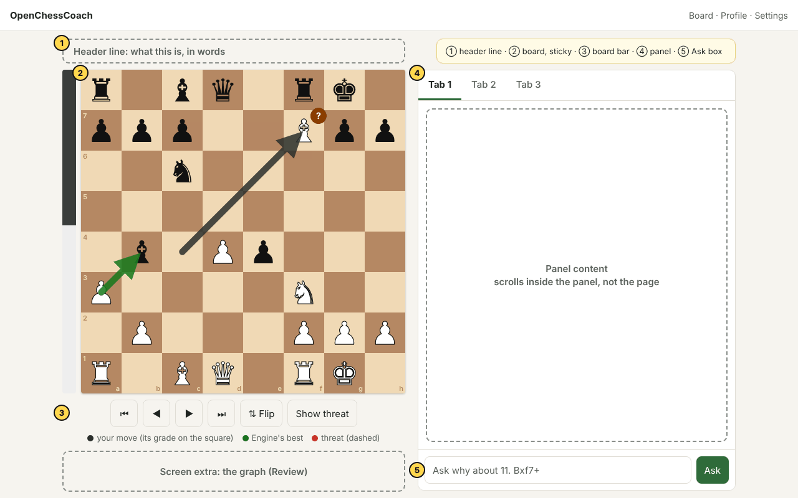
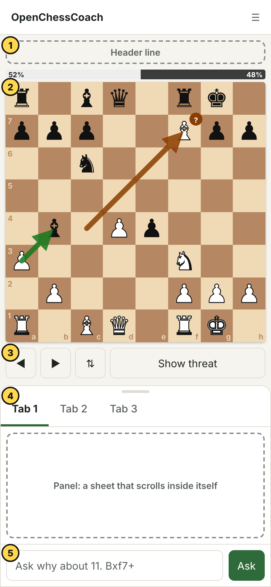
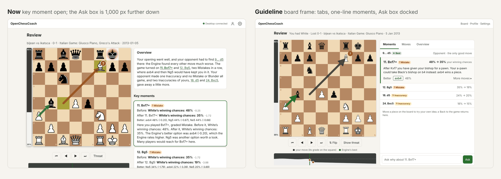
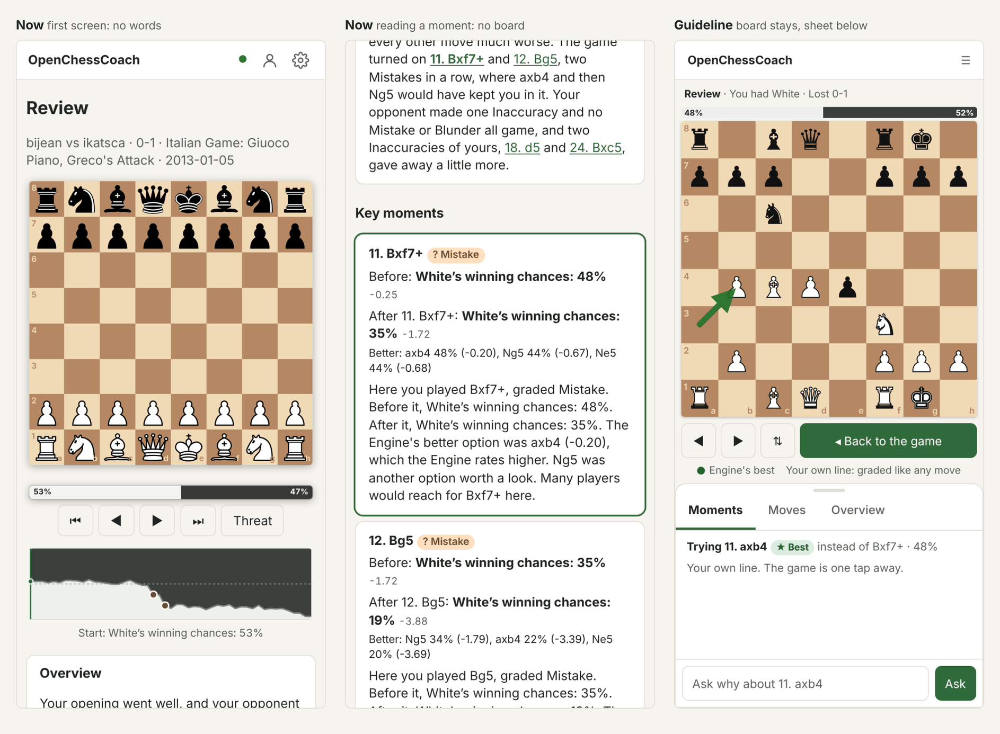

# OpenChessCoach interface guidelines

How every screen in OpenChessCoach looks and behaves. Read this before you add or change anything a
Player sees. The rules come from the owner's direction (simpler, chess first, the main elements
always at hand, collapsible where it helps) and from a playtest with three kinds of Player at
desktop and phone sizes ([`docs/research/ui-ux-playtest.md`](../research/ui-ux-playtest.md)).
They were drafted on a Doop canvas, where the layout sketches below come from
([how](#how-these-guidelines-were-made)).

Words follow `CONTEXT.md`: Player, Coach, Engine, Move Grade, Winning Chances, Review, Lesson, Hint,
Why Question, Engine Game.

## Five principles

1. **The board is the screen.** Every screen with a board is built around it. The board is the
   largest thing on the screen and never scrolls out of view while the Player reads about it, asks
   about it or chooses what to do on it.
2. **Every board can be explored.** Wherever the app shows a position to learn from, the Player can
   move a piece to try their own idea and get back in one step. A board that refuses a move says why.
3. **What the Player needs next is within reach.** The step buttons, the move list and the box to
   ask the Coach sit next to the board, at a fixed place, on every screen. Nothing the Player uses on
   every move lives at the bottom of a long page.
4. **One idea once.** A number, a move or a label appears once per view. Detail the Player needs only
   sometimes (evaluations, more Engine lines, the graph, earlier Coach messages) is collapsed, one
   tap away, and the app remembers whether the Player opened it.
5. **The same thing looks the same everywhere.** One arrow colour means one thing on every screen.
   One button style means one kind of action. Move Grades keep their symbol, word and colour.

## The board frame

Every screen with a board (Board, Engine Game, Lesson, Puzzle, Review) uses the same frame. A
screen fills the frame's slots; it doesn't invent its own layout.

| Slot | What goes in it | Always visible |
| --- | --- | --- |
| **Header line** | What this is, in words: "Review · You had Black · Lost 1-0", "Lesson · Forks · 2 of 5" | Yes |
| **Board** | The board, with the Winning Chances bar beside it on desktop and above it on a phone | Yes |
| **Board bar** | Step buttons (⏮ ◀ ▶ ⏭), Flip board, and the screen's one or two board tools (Threat, Hint) | Yes |
| **Panel** | The screen's content: the Coach, the moves, the key moments, the Lesson text | Its top and its Ask box |
| **Ask box** | The Why Question box, docked at the bottom of the panel, naming the move it asks about | Yes, where the screen allows a Why Question |

### Desktop (from 821 px wide)

- The board column is sticky: it stays put while the panel scrolls.
- The panel is as tall as the board column (the viewport less the header) and scrolls inside
  itself. The page itself doesn't scroll on a board screen at 1280 by 800.
- The Ask box is docked at the foot of the panel, never after the panel's content.
- The move list is in the panel, not under it: a "Moves" tab, or a section at the top of the panel
  on screens that have no tabs.

### Phone (up to 820 px wide)

- The board stays at the top and doesn't scroll away. The panel below it scrolls inside itself, like
  a sheet. When the Player needs the full height (reading a long overview, typing a question), the
  board shrinks to a strip (about a third of its size), and a tap on the strip brings it back.
- The Winning Chances bar lies flat above the board, so the board keeps the full width.
- The board bar sits under the board, inside thumb reach, with buttons at least 44 px square.
- The Ask box sits at the bottom of the screen, above the keyboard while typing, and the answer
  appears right above it, not in a log further down.
- A choice the Player must make on this move (Take the move back or Carry on, Continue, Try another
  move) is shown with its reason in the first screen, never below the fold.

## Exploring a position

Every board that shows a position to learn from lets the Player move pieces: the Review, a Lesson
once it is over, a solved Puzzle, an Engine Game once it is over, and the Board. Not a Lesson in
progress: the next decision's answer stays kept back (ADR 0012), so no free board, Engine grade or
arrow there may show a move the Lesson will ask for.

- A move on such a board starts a **variation**. The move list shows it indented under the move it
  branches from, and the board bar shows **Back to the game**, which drops the variation and returns
  to where the Player left the game line.
- The browser's Engine grades variation moves on screen, as it does in play (ADR 0007). A Why
  Question about a variation sends only the moves; the desktop's Engine works out the Coach's facts,
  as for every Coach call. While the desktop can't be reached, the Ask box says so instead of
  taking the question.
- Stepping back and playing a different move never deletes the rest of a line without asking. On the
  Board it starts a variation; where a screen keeps only one line, it asks first.
- A Review's "Better" moves, the Board's Engine lines and the moves in the overview are buttons: a
  tap shows the move on the board as a variation.
- Where moving is not allowed (the Engine is to move, a Lesson decision is waiting for the Lesson's
  answer only, a Puzzle before it is solved), a refused move says why in one line beside the board
  ("It's the Engine's move"). It never fails silently.
- Every board has Flip board. The header line says which side the Player had, so a board shown from
  Black's side doesn't look wrong.

## Collapsing and density

Collapse what the Player needs only sometimes. Never collapse the board, the board bar, the Ask box
or a choice the Player must make now.

| Element | Default | Why |
| --- | --- | --- |
| Review overview | Open on first visit, collapsed to its first sentence after | Read once, then it's in the way |
| Key moment | The open one expanded; the others one line each: move, Move Grade, what changed ("48% → 35%") | One moment at a time |
| "Better" moves | The best one as a move button; the others behind "More moves" | The fix, not a list |
| Evaluations (+0.65) | Hidden at the beginner and casual levels; shown small after the percentage at the club level; a setting either way | Two numbers for one idea |
| Engine lines | Top line shown on the Board and in the Review; lines 2 to 5 behind "More lines" | Club players want one; nobody needs five at once |
| Winning Chances graph | Shown on desktop; collapsed to a one-line strip on a phone, which opens it | It costs 180 px on a phone |
| Earlier Coach messages | The latest answer shown; earlier ones behind "Earlier" | The log grows with every move |
| "How moves are written" | A help link next to the first notation the Player meets, not at the foot of the page | Help where it's needed |

A collapsed section always shows its heading and a one-line summary, uses a native `
` or a
button with `aria-expanded`, and remembers its state on the device in `localStorage`, read synchronously before the first paint so
nothing jumps, and wrapped in try/catch so a blocked storage only loses the memory, never the
screen. (The offline store in `lib/storage.ts` is asynchronous and holds the pairing token and
games, ADR 0003; it is the wrong place for this.)

## Numbers and words

- **Percentages first, always from one side.** Winning Chances are the number the Player reads. In a
  Review and a Lesson, they are the Player's own ("your winning chances 48% → 35%"). On the Board and
  in Engine lines they are White's, as on Lichess.
- **One sign convention.** Where an evaluation shows, "+" always means White is better, on every
  screen, whoever is to move and whoever the Player is. The percentage stays the Player's own where
  the screen says so; only the evaluation's sign is fixed. Today `evaluation` in
  `packages/shared/src/winning-chances.ts` follows the side the percentage is for, so this rule
  changes that one formatter, not each screen.
- **A label never repeats inside its value.** "Black's winning chances: 68%" is a label and a value;
  inside a sentence it is "68%". This holds for the Coach's text too: what the Coach brief gives the
  Coach is a value, not a label.
- **Each number once per view.** A key moment shows Before and After once. The Coach's paragraph
  explains; it doesn't repeat the numbers above it.
- **Say the move a question is about.** The Ask box's placeholder names it: "Ask why about 11.
  Bxf7+".
- **No internal names on screen.** No Puzzle ids, no "level 1", no model names where a plain word
  will do.
- **Notation with help.** A beginner meets notation with a help link beside it the first time; moves
  in Coach text are buttons that show the move on the board.

## Arrows and marks

One colour, one meaning, on every board. At most two arrows show by default; the rest come on when
the Player asks (the moment's "Show all", Threat, a hovered Engine line).

| Colour | Means | Where |
| --- | --- | --- |
| Ink (near black) | The move that was played; its Move Grade shows as the badge on its square, not as the arrow's colour | Review, Engine Game, Lesson feedback |
| Green | The Engine's best move | Review, Engine lines, Engine Game Hints that show the move; in a Lesson only where ADR 0012 allows (never a move the Lesson will ask for) |
| Blue | Another good move (the Engine's second choice, or the Coach's alternative) | Review, Board |
| Red, solid | A move that went wrong, when it isn't the move played (the Coach's red) | Review, Lesson feedback, Why Questions |
| Red, dashed | The opponent's threat | Threat, the Blunder pause (the move that wins the piece) |
| Orange | The opponent's reply the Coach points to | Review, Lesson feedback, Why Questions |

The played move's arrow is ink, not its Move Grade's colour, because the grade colours overlap the
others: a Mistake's dark orange is the reply's orange, and a Good move's green is the best
move's green.

- Every board that draws arrows shows a legend of the colours on it now, as one line under the board
  (● played ● best ● threat), and every arrow keeps its accessible name.
- The played move's arrow is drawn last, so another arrow never hides it.
- A threat is dashed as well as red, so it differs from a Blunder's red without relying on colour.
- The Blunder pause draws the move that punishes the blunder (red, dashed), so the reason is on the
  board as well as in words.
- Coordinates are at least 11 px with 4.5:1 contrast against their square, and sit in the corner
  away from the piece.

## Controls

- **One primary action per view**, as a filled button (`button`): Start the Review, Continue, Take the
  move back. Everything else is `secondary`.
- **Board tools are toggles** with `aria-pressed` and a visible on state (filled), and say what they
  do: "Show threat", not "Threat". A tool that is on says so on every screen it carries over to.
- **Destructive actions go behind a menu and a confirmation**: Resign, New game, New board, Offer a
  draw sit in a "⋯ Game" menu, away from Hint and the step buttons.
- **A disabled button says why**, in its title and next to it ("Hint comes back once you've decided
  on the take-back").
- **Keyboard**: ← → Home End step moves on every board screen, including a game in progress (they
  show earlier positions without changing the game). F flips the board. Enter in the Ask box sends.
- **Touch**: every target is at least 44 by 44 px; nothing depends on hover.

## Waiting and feedback

- The Coach's status says what it is doing ("The Coach is reading the Engine's lines…") whenever a
  job runs. "Coach ready" shows only when nothing runs.
- An answer appears where the Player is looking: above the Ask box, next to the board, never further
  down the page.
- Long jobs (a Review) show what is ready as soon as it is ready: the first key moment before the
  last.

## Navigation and the main menu

- The main menu leads with one **Continue** card that follows the Player: the next Lesson for a
  beginner, a game waiting for its Review, an unfinished Engine Game. Below it, three equal cards:
  Learn, Play, Review your games. The Board is a full card or a header link, never a footnote.
- The header carries the Board, the Player Profile and Settings on every screen.
- The game list comes before the import forms, which collapse to one "Import more games" button once
  the Player has games. Losses look different from wins, and the list filters by result.

## Screen recipes

### Review

- Header line: opponent, the Player's side, the result, the opening.
- Panel tabs: **Moments** (default), **Moves**, **Overview**. Moments lists the key moments as one-line
  rows; the open one expands in place with the Coach's explanation and the best move as a button.
- The graph sits under the board bar on desktop; a strip on a phone.
- The board is free to move: any move starts a variation, "Back to the game" returns.
- The Ask box is docked at the panel's foot and asks about the move on the board.

### Lesson

- Panel: the part's title and key idea, the decision prompt, then the feedback for the last move,
  with Continue or Try another move as the first thing under it.
- The board takes the Lesson's moves only while a decision waits; arrows and highlights follow
  `lessonArrows` and `lessonHighlights` in `lib/arrows.ts` (ADR 0012).
- After a decision's feedback, the board scrolls nowhere: Continue keeps the board where it was.
- At the end, "What you learned" and the next Lesson, with the final position free to explore.

### Engine Game

- Board bar: step buttons, Hint, Show threat, and the "⋯ Game" menu (Offer a draw, Resign, New game).
- The Blunder pause appears in the panel's first screen on a phone, with the punishing move drawn on
  the board.
- During play the step buttons and arrow keys show earlier positions; the board says "You're looking
  at move 12. ▶ back to the game" until the Player returns.

### Board

- Panel tabs: **Lines** (the top Engine line, then "More lines"), **Moves** (with variations), **Coach**.
- Engine lines are buttons; a hover or tap previews the line on the board.

### Puzzle

- The Puzzle's Theme in the header line, a Hint before "Show the solution", and the solved position
  free to explore.

## Tokens

The existing tokens in `packages/web/src/app.css` stay: `--bg`, `--panel`, `--text`, `--muted`,
`--line`, `--accent`, `--danger`, with their dark-mode values, `--board-max` and `--screen-max`. New
work adds tokens there instead of literal colours:

- `--arrow-played` (ink), `--arrow-best`, `--arrow-alt`, `--arrow-threat`, `--arrow-reply`,
  which every arrow takes through its kind in `lib/arrows.ts` (`ARROW_LOOK`). The Coach's brushes
  map onto them: green best, blue another good move, red a move that went wrong (solid, not
  dashed), yellow the opponent's reply, and whichever arrow is the move played is ink.
- `--app-head` (the header's height) and `--board-cap` (the largest board), from which the frame
  sizes the board to fit one screen on desktop.
- `--tap: 44px`, the smallest touch target.
- `--coord-size: 11px` for the coordinates, whose colours keep 4.5:1 on their square.

## Checking a screen against these guidelines

A PR that changes what a Player sees checks these, at 1280 by 800 and 390 by 844, in its evidence:

- [ ] The board is fully visible in the first screen and stays visible while the Player reads the
      panel, opens a section or types a question.
- [ ] The Ask box (where the screen has one) is visible without scrolling the page.
- [ ] A move on any board that shows a position to learn from either plays as a variation or says
      why it can't.
- [ ] No number, move or label appears twice in one view.
- [ ] Arrows use the colour table, show a legend, and the played move's arrow is on top.
- [ ] One primary button per view; destructive actions are behind a menu and a confirmation.
- [ ] Every collapsed section shows a heading and a one-line summary.
- [ ] Touch targets are at least 44 px on a phone.

## How these guidelines were made

1. Three playtesters used the app as a beginner, a casual improver and a club player at desktop and
   phone sizes ([`docs/research/ui-ux-playtest.md`](../research/ui-ux-playtest.md)).
2. The findings and the owner's direction went onto a canvas in
   [Doop](https://github.com/kgoedecke/doop), run locally and driven by Claude Code over Doop's MCP
   server: the owner's direction as saved decisions, these guidelines as the canvas's style guide,
   the current screens as reference frames, and the layout sketches as frames reviewed with Doop's
   screenshot checkpoints.
3. The sketches in `images/` are Doop frame exports. They show where things go, not how they look:
   colours, type and spacing stay with `app.css`.

When the guidelines change, change this file in the same PR as the screens it affects, and keep the
sketches in step.
